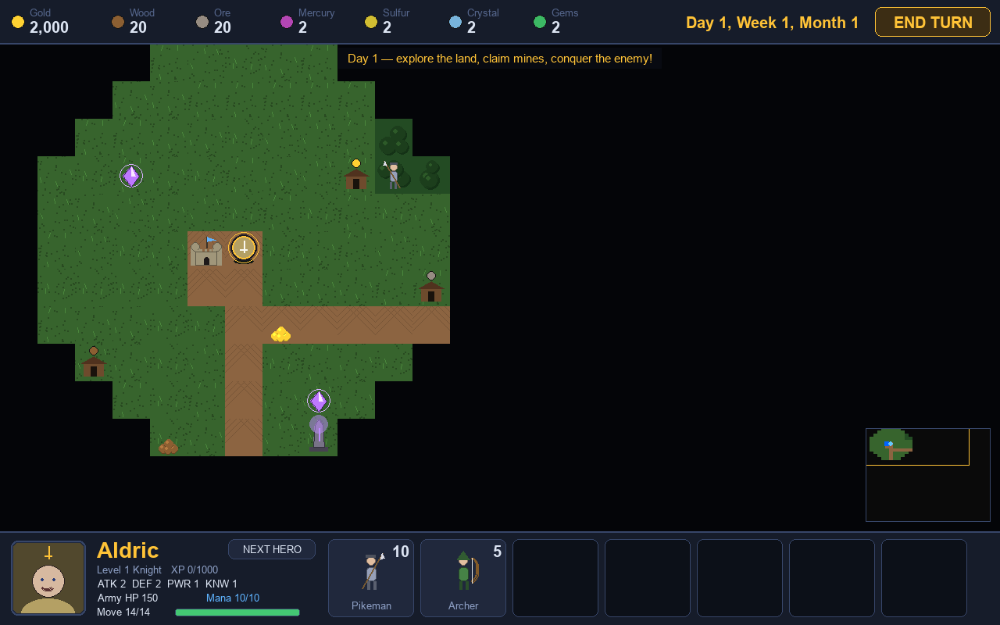
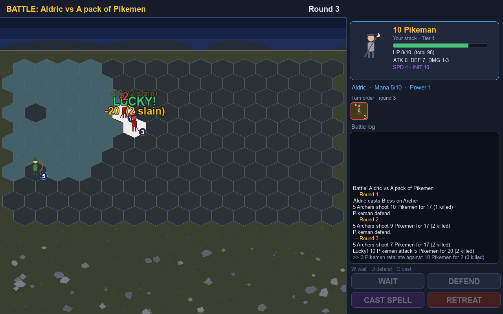
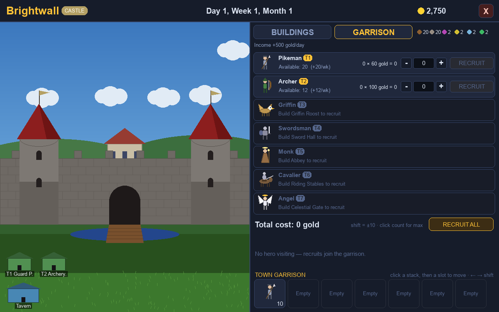

# HeroForge

A turn-based fantasy strategy game in Python and pygame. Explore a map under fog of war, claim
mines, grow your towns, recruit armies and fight tactical battles on a hex grid against a
computer opponent.

All graphics and sounds are generated in code: there are no image or audio files.



## Features

- **Adventure map:** a 32×32 map with fog of war, rivers, mountains, mines, guarded treasure,
  obelisks that reveal distant land, and a minimap. Heroes walk with smooth animation.
- **Tactical combat:** a 15×11 hex grid with initiative order, melee and ranged attacks,
  retaliation, defend and wait, 20 spells in four schools, luck, morale and a tactics phase.
- **Towns:** two factions (Castle and Necropolis) with illustrated town views, building trees,
  weekly creature growth, recruiting and garrison management.
- **Heroes:** levels and experience, secondary skills chosen on level-up, spellbooks and
  15 artifacts.
- **AI opponent:** the enemy explores, captures mines and towns, builds, recruits and attacks you.
- **Save and load** (Ctrl+S), with synthesized sound effects.




## Running it

Requires Python 3.9+ and pygame.

```bash
python3 -m venv .venv
.venv/bin/pip install -r requirements.txt
.venv/bin/python main.py
```

## Controls

| Action | Input |
|---|---|
| Move a hero | click a tile to plan the route, click again to walk |
| Scroll the map | WASD / arrow keys, or click the minimap |
| Information about a tile | right-click |
| Hero screen / cycle towns / next hero | H / T / Tab |
| End turn | Enter or END TURN |
| Save | Ctrl+S |
| Combat: wait / defend / cast spell | W / D / C |

Win by defeating every enemy hero and capturing every enemy town.

## Project layout

- `main.py`: entry point, global game state and fonts
- `engine/`: game rules (heroes, towns, combat, hex grid, AI, save/load, sound synthesis)
- `scenes/`: screens (main menu, adventure map, town, combat, hero, end)
- `art/`: procedural drawing for terrain, creatures, heroes, towns and UI
- `data/`: creatures, buildings, spells, artifacts and the scenario map as JSON
